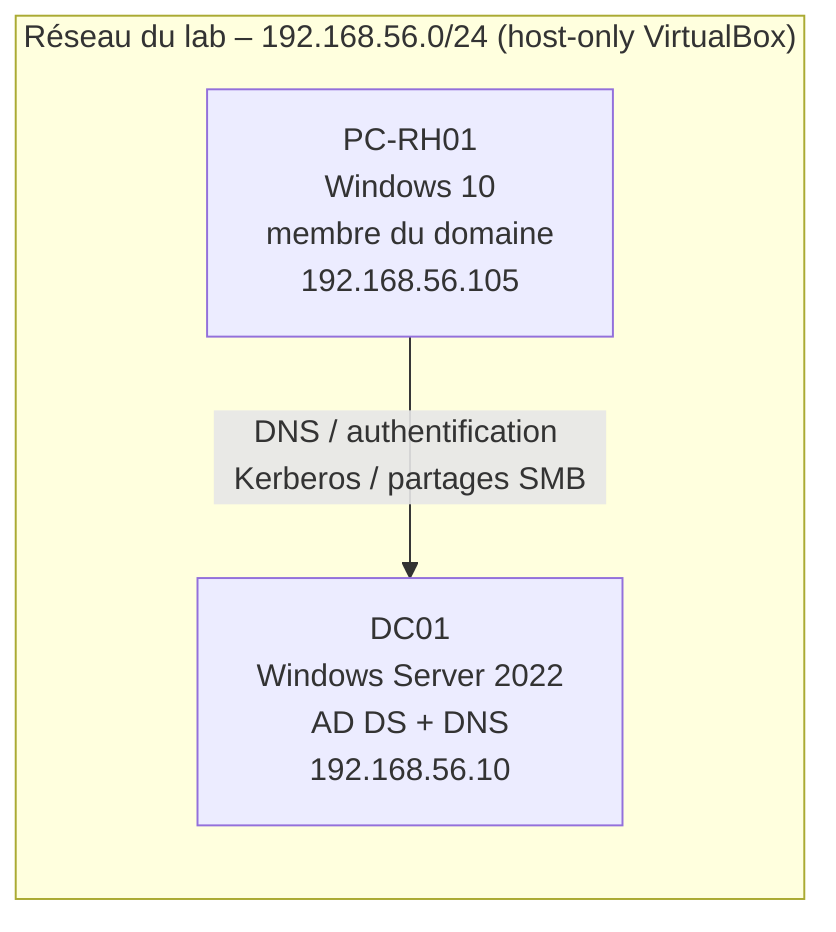
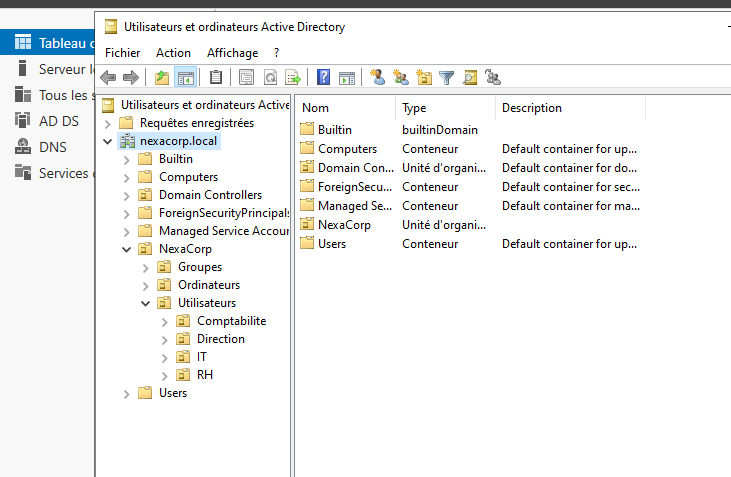
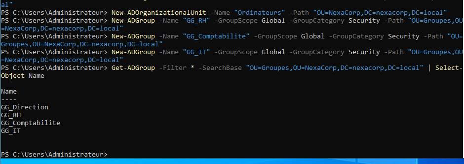
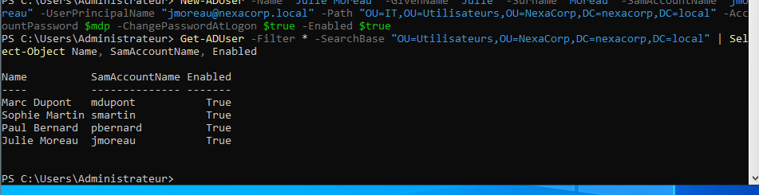
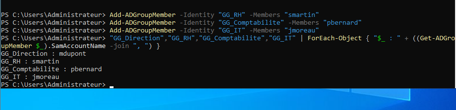
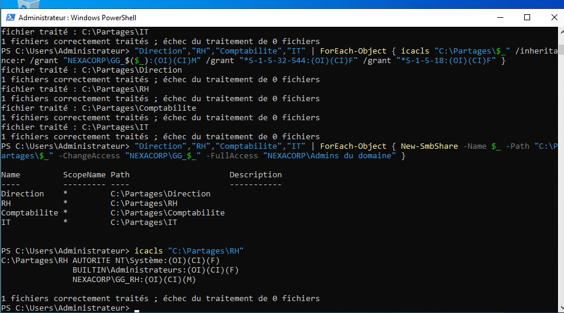
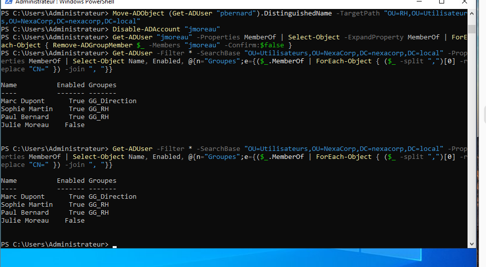
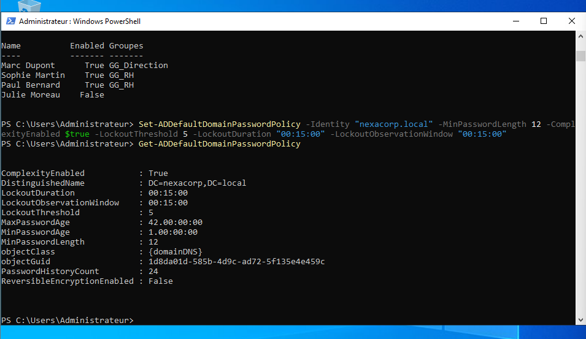
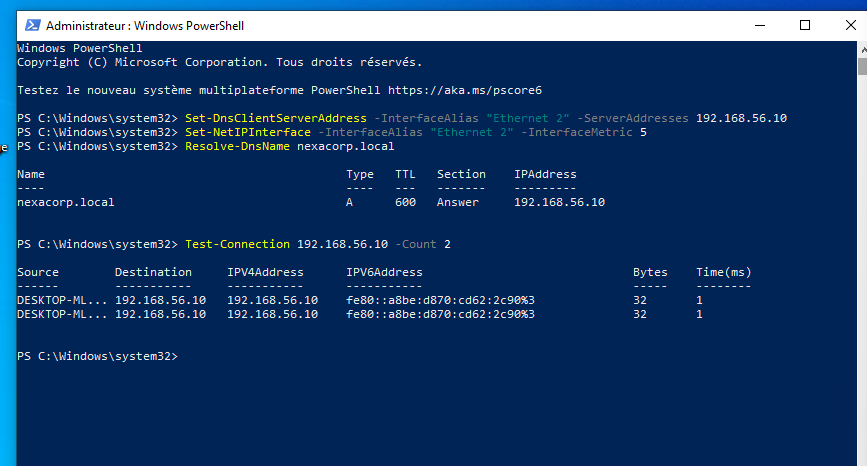
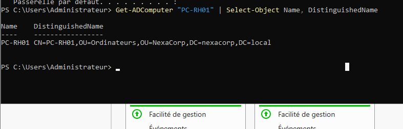

# Lab Active Directory – NexaCorp

Mise en place et sécurisation d'un annuaire **Active Directory** pour une PME fictive, **NexaCorp**, dans un environnement virtualisé.
L'objectif est de reproduire les tâches quotidiennes d'un administrateur systèmes et sécurité : organisation de l'annuaire, gestion des identités et des accès, droits sur les partages, cycle de vie des comptes et règles de sécurité par GPO.

---

## Compétences démontrées

| Domaine | Compétence |
|---|---|
| **Active Directory** | Installation d'un contrôleur de domaine, DNS, conception d'une arborescence d'OU |
| **Gestion des identités (IAM)** | Création de comptes et de groupes, appartenance par service, cycle de vie (arrivée, mobilité, départ) |
| **Contrôle d'accès** | Droits NTFS et partages SMB par groupe, principe du **moindre privilège** |
| **Durcissement** | Politique de mots de passe (12 caractères, complexité), verrouillage après 5 échecs |
| **GPO** | Verrouillage automatique de session après 5 minutes d'inactivité |
| **Postes de travail** | Configuration DNS client, jonction d'un poste Windows au domaine |
| **Automatisation** | Scripts PowerShell commentés et réutilisables (module ActiveDirectory) |
| **Méthode** | Chaque action réalisée dans la console graphique **et** en PowerShell |

---

## Architecture



| Élément | Valeur |
|---|---|
| Domaine | `nexacorp.local` (NetBIOS : `NEXACORP`) |
| Contrôleur de domaine | `DC01` – Windows Server 2022 – `192.168.56.10` |
| Poste client | `PC-RH01` – Windows 10 22H2 |
| Hyperviseur | Oracle VirtualBox 7.2 |

---

## Organisation de l'annuaire

```
nexacorp.local
└── NexaCorp
     ├── Utilisateurs
     │    ├── Direction      Marc Dupont   (mdupont)
     │    ├── RH             Sophie Martin (smartin), Paul Bernard (pbernard)
     │    ├── Comptabilite
     │    └── IT             Julie Moreau  (jmoreau) – compte désactivé
     ├── Groupes             GG_Direction, GG_RH, GG_Comptabilite, GG_IT
     └── Ordinateurs         PC-RH01
```

**Choix de conception**

- Utilisateurs, groupes et ordinateurs sont rangés dans des OU séparées pour pouvoir leur appliquer des GPO différentes.
- Les OU sont **protégées contre la suppression accidentelle**.
- **Les OU servent à ranger et à appliquer des règles ; les groupes servent à donner des droits.** Un employé appartient à une seule OU mais peut appartenir à plusieurs groupes.
- Convention de nommage des groupes : `GG_<Service>` (groupe global de sécurité).



---

## Réalisation

### 1. Structure, groupes et comptes

- 7 OU, 4 groupes de sécurité globaux, 4 comptes utilisateurs.
- Mot de passe provisoire saisi au clavier, **jamais écrit dans un script**, et changement obligatoire à la première connexion.

| Groupes | Utilisateurs |
|---|---|
|  |  |



### 2. Partages et droits NTFS – moindre privilège

Un dossier partagé par service (`\\DC01\RH`, `\\DC01\Comptabilite`…).
L'héritage NTFS est supprimé : seuls le **groupe du service** (Modification), les Administrateurs et SYSTEM (Contrôle total) ont accès.

```
C:\Partages\RH  AUTORITE NT\Système:(OI)(CI)(F)
                BUILTIN\Administrateurs:(OI)(CI)(F)
                NEXACORP\GG_RH:(OI)(CI)(M)
```



### 3. Tickets du cycle de vie des comptes

| Ticket | Action |
|---|---|
| « Sophie Martin est bloquée » | Déblocage du compte |
| « Paul Bernard passe de la Comptabilité aux RH » | Retrait de `GG_Comptabilite`, ajout à `GG_RH`, déplacement dans l'OU RH |
| « Julie Moreau quitte l'entreprise » | Compte **désactivé** (pas supprimé, pour la traçabilité) et retiré de tous ses groupes |



### 4. Politique de mots de passe et de verrouillage

| Paramètre | Valeur |
|---|---|
| Longueur minimale | 12 caractères |
| Complexité | Activée |
| Historique | 24 mots de passe |
| Seuil de verrouillage | 5 échecs |
| Durée de verrouillage | 15 minutes |



### 5. GPO de verrouillage de session

`GPO_Verrouillage_Ecran`, liée à l'OU **Utilisateurs** :
écran de veille activé, protégé par mot de passe, délai de **300 secondes**.
Créée avec la console *Gestion des stratégies de groupe* ; l'équivalent PowerShell est fourni dans [`scripts/07-gpo-verrouillage-ecran.ps1`](scripts/07-gpo-verrouillage-ecran.ps1).

### 6. Jonction d'un poste au domaine

- DNS du poste pointé vers DC01, carte du lab rendue prioritaire.
- Vérification : résolution de `nexacorp.local` et ping de DC01.
- Poste renommé `PC-RH01` et rangé directement dans l'OU **Ordinateurs**.

| Tests DNS et réseau | Poste dans l'OU Ordinateurs |
|---|---|
|  |  |

---

## Scripts

| Script | Rôle | Où l'exécuter |
|---|---|---|
| [`01-structure-ou.ps1`](scripts/01-structure-ou.ps1) | Arborescence des OU | DC01 |
| [`02-groupes.ps1`](scripts/02-groupes.ps1) | Groupes de sécurité par service | DC01 |
| [`03-utilisateurs.ps1`](scripts/03-utilisateurs.ps1) | Comptes + appartenance aux groupes | DC01 |
| [`04-partages-droits-ntfs.ps1`](scripts/04-partages-droits-ntfs.ps1) | Dossiers partagés, NTFS et SMB | DC01 |
| [`05-tickets-cycle-de-vie.ps1`](scripts/05-tickets-cycle-de-vie.ps1) | Déblocage, réinitialisation, mobilité, départ | DC01 |
| [`06-politique-mots-de-passe.ps1`](scripts/06-politique-mots-de-passe.ps1) | Politique de mots de passe du domaine | DC01 |
| [`07-gpo-verrouillage-ecran.ps1`](scripts/07-gpo-verrouillage-ecran.ps1) | GPO de verrouillage (équivalent PowerShell) | DC01 |
| [`08-jonction-poste-client.ps1`](scripts/08-jonction-poste-client.ps1) | DNS client et jonction au domaine | Poste client |

Les scripts vérifient l'existant avant de créer un objet et peuvent être relancés sans créer de doublons (sauf le script 08).
Un aide-mémoire des commandes est disponible dans [`docs/aide-memoire-commandes.md`](docs/aide-memoire-commandes.md).

---

## Prochaines étapes

- [ ] Tests depuis le poste client avec un compte du domaine : accès autorisé à `\\DC01\RH`, accès refusé à `\\DC01\Comptabilite`, application de la GPO (`gpresult /r`)
- [ ] GPO de blocage des périphériques USB sur l'OU Ordinateurs
- [ ] Comptes d'administration séparés des comptes utilisateurs (modèle de tiering)
- [ ] Segmentation réseau avec pfSense (VLAN, règles de filtrage)
- [ ] Supervision des événements AD avec Wazuh et Sysmon

---

## Auteur

**Awelou TAFON** – Mastère Cybersécurité, Sup de Vinci (Paris)
Recherche d'alternance en cybersécurité (SOC · Réseau · Audit)

<!-- Ajoutez vos liens : LinkedIn, e-mail professionnel -->

> Environnement de laboratoire : tous les comptes et noms sont fictifs.
